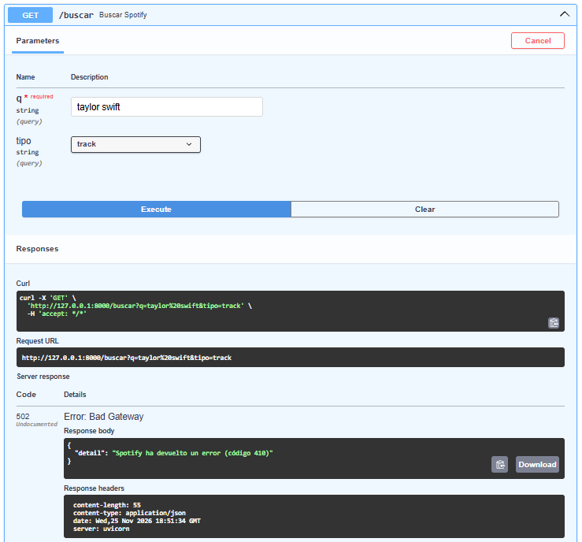
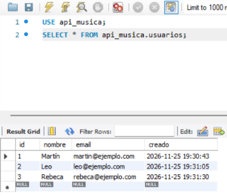
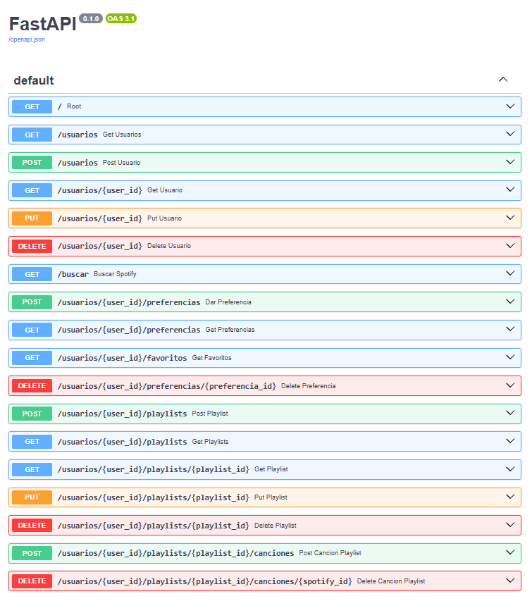
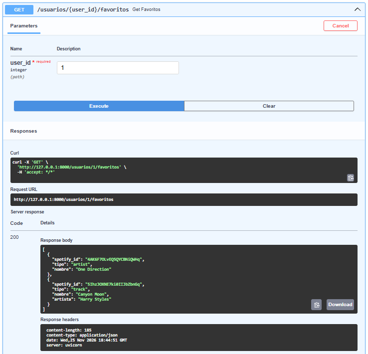
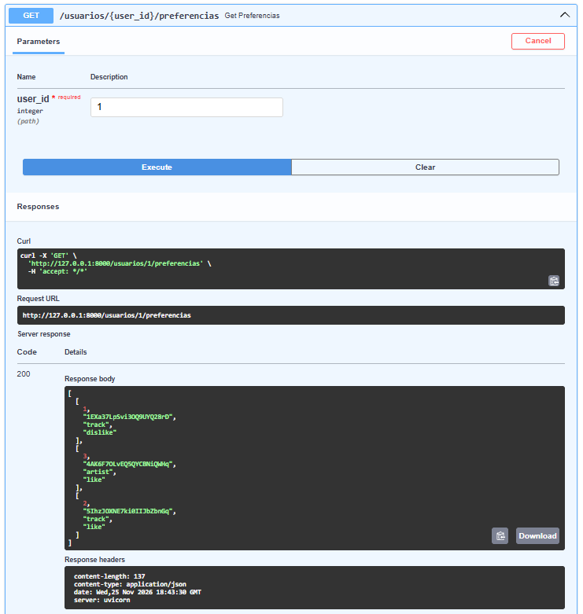
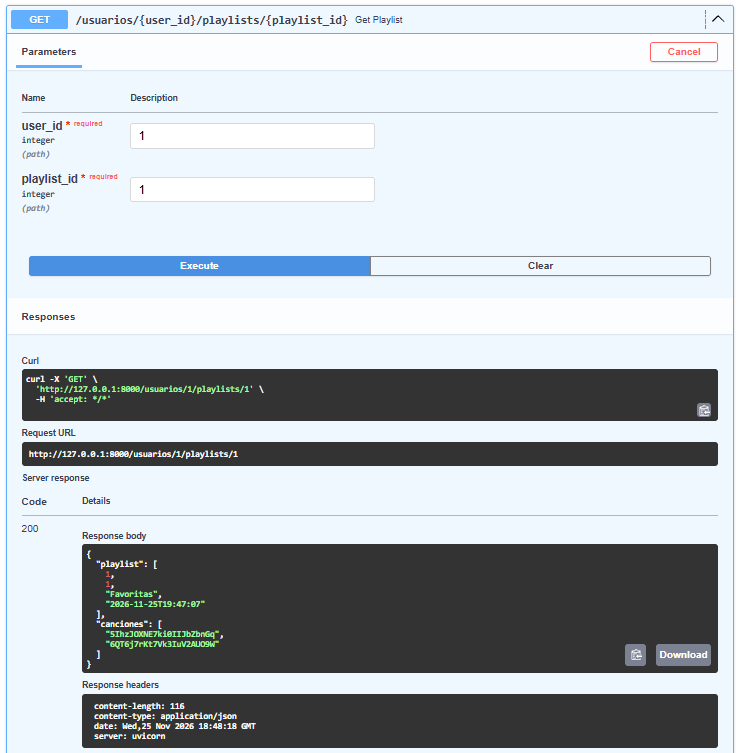
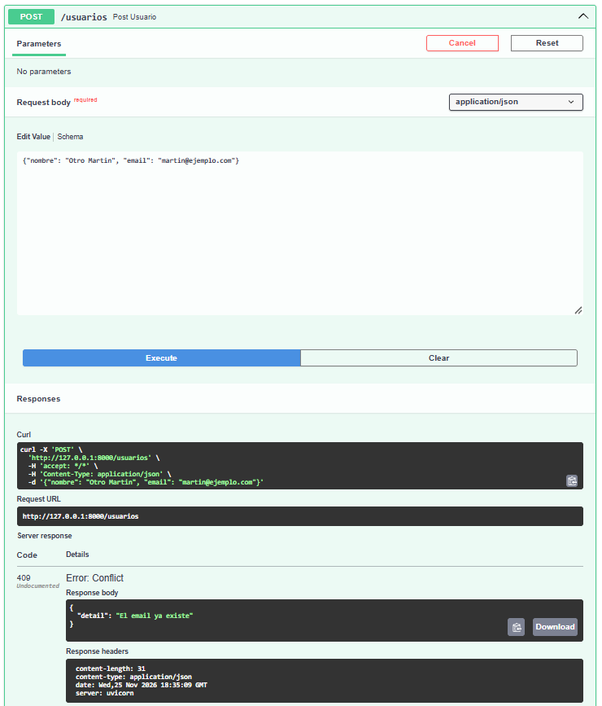

# API de música con Spotify

**Unidad 2:** Desarrollo de una API Completa

***Repositorio de Github:*** https://github.com/nereacarp/api-spotify 

## 1. Introducción

API REST hecha con **FastAPI** que gestiona usuarios, sus preferencias musicales (like y dislike) y sus playlists y se conecta a la API de **Spotify** para buscar canciones y artistas. Los datos de los usuarios se guardan en **MySQL** y los de música se piden a Spotify. Se prueba con `/docs`.


<p align="left">
  
  
  
  
  
</p>

## 2. Cómo instalarlo y ejecutarlo

1. Clonar el repositorio y entrar en la carpeta.
2. Crear y activar el entorno virtual: `python -m venv venv` y `venv\Scripts\activate`.
3. Instalar las librerías: `pip install -r requirements.txt`.
4. Copiar `.env.template` a `.env` y rellenarlo con los datos de MySQL y las credenciales de Spotify.
5. Ejecutar `sql/esquema.sql` en MySQL para crear las tablas.
6. Arrancar con `uvicorn main:app --reload` y abrir `http://127.0.0.1:8000/docs`.

## 3. Estructura

El código se divide en tres partes: la **API** (`main.py`), la **base de datos** (`sql/` y `configuration/`) y **Spotify** (`service/`).

```
api-spotify/
├── main.py                      # la API : clases de Pydantic y todos los endpoints
├── requirements.txt             # librerías necesarias
├── .env.template                # plantilla de las variables de entorno (vacía)
├── configuration/
│   └── connections.py           # crea la conexión con MySQL
├── service/
│   └── spotify_service.py       # token y búsqueda en la API de Spotify
├── sql/
│   └── esquema.sql              # tablas de la base de datos
└── img/                         # capturas
```

## 4. Explicación del código

### 4.1 Integración con Spotify (`service/spotify_service.py`)

Primero se consultó la documentación de Spotify y se sacó la lógica de lo que se pretendía hacer. Según la documentación, para consultar canciones y artistas hace falta un token. Como la API solo consulta datos públicos de Spotify (canciones y artistas), se usa el flujo *Client Credentials*. En este flujo la app envía su `client_id` y su `client_secret` (guardados en `.env` para no subirlos a GitHub) y Spotify devuelve un `access_token` que dura una hora. Este flujo no da *refresh token*, así que cuando caduca se tiene que pedir otro con las mismas credenciales.

Antes de integrarlo en la API se probó solo la conexión con Spotify, para comprobar que el flujo del token funcionaba. Una vez comprobado, se escribió la lógica del servicio en `service/spotify_service.py` dividido en dos partes: la gestión del token y las consultas.

La **gestión del token** se hace en dos pasos, ya que el token caduca a la hora y no es necesario pedir uno nuevo en cada consulta:

- **`pedir_token()`:** hace un `POST` con las credenciales. 
  - Si Spotify responde `200`, guarda el `access_token` y calcula cuándo caduca (`time.time() + expires_in`). 
  - Si no, lanza una excepción (`error 500`), ya que es un fallo de configuración y no de quien usa la API.
- **`obtener_token()`:** devuelve el token guardado y solo pide uno nuevo si no hay ninguno o si le queda menos de un minuto de vida (es la única que llama a `pedir_token()`).

Las **consultas** siguen todas el mismo patrón. Según la documentación, las peticiones deben llevar el token en la cabecera `Authorization: Bearer <token>`, así que cada función llama primero a `obtener_token()` para tener un token válido y después hace un `requests.get` a la URL de su endpoint con esa cabecera:

- **`obtener_cancion(id)`:** devuelve los datos de una canción (`/v1/tracks/{id}`).
- **`obtener_artista(id)`:** devuelve los datos de un artista (`/v1/artists/{id}`).
- **`buscar(texto, tipo)`:** busca en `/v1/search` con los parámetros `q`, `type` (`track` o `artist`), `limit=10` y `market=ES` (para que sepa de qué país es la búsqueda).

Si Spotify falla, estas funciones no lanzan el error sino que devuelven `{"error": "..."}` y es el endpoint quien decide qué código HTTP responder.

<p align="center">
  <a href="img/error_spotify.png"></a><br />
  <sub><code>GET /buscar</code> cuando Spotify falla: la API responde <code>502</code></sub>
</p>

**Fuentes** (documentación oficial de Spotify): [Getting started with Web API](https://developer.spotify.com/documentation/web-api/tutorials/getting-started), [Apps](https://developer.spotify.com/documentation/web-api/concepts/apps), [Authorization](https://developer.spotify.com/documentation/web-api/concepts/authorization), [Client Credentials Flow](https://developer.spotify.com/documentation/web-api/tutorials/client-credentials-flow), [Access Token](https://developer.spotify.com/documentation/web-api/concepts/access-token), [Search for Item](https://developer.spotify.com/documentation/web-api/reference/search), [Get Track](https://developer.spotify.com/documentation/web-api/reference/get-track) y [Get Artist](https://developer.spotify.com/documentation/web-api/reference/get-an-artist). Para las peticiones desde Python: [Requests: Quickstart](https://requests.readthedocs.io/en/latest/user/quickstart/).

### 4.2 Base de datos (`sql/esquema.sql` y `configuration/connections.py`)

Posteriormente se diseñó la base de datos en MySQL a partir de lo que pide el enunciado: usuarios, sus preferencias musicales (like y dislike) y sus playlists. De Spotify solo se guarda el id de cada canción o artista. El resto de datos (nombre, artista...) se piden a Spotify cuando hacen falta y así la base de datos no repite información que ya tiene Spotify.

Con esto se crearon cuatro tablas en `sql/esquema.sql`:

- **`usuarios`:** `id` automático, `nombre`, `email` y fecha de creación. El `email` es `UNIQUE`, así no puede haber dos usuarios con el mismo.
- **`preferencias`:** `usuario_id`, `spotify_id`, `tipo` (`track` o `artist`) y `valoracion` (`like` o `dislike`). Los dos `ENUM` hacen que MySQL solo admita esos valores y `tipo` usa los mismos nombres que Spotify. Además, `UNIQUE (usuario_id, spotify_id, tipo)` impide repetir la misma canción o artista para un usuario.
- **`playlists`:** `usuario_id`, `nombre` y fecha de creación.
- **`playlist_canciones`:** `playlist_id` y `spotify_id`, con `UNIQUE (playlist_id, spotify_id)` para no repetir una canción en la misma playlist.

Las tablas que dependen de otra llevan una `FOREIGN KEY`, que exige que el usuario (o la playlist) exista, con `ON DELETE CASCADE` que borra también sus preferencias, playlists y canciones si se borra.

Para conectar con MySQL, `configuration/connections.py` define `make_connection()`, que devuelve una conexión nueva con `mysql.connector`. Los datos de conexión (host, usuario, contraseña y nombre de la base de datos) se leen del `.env` con `python-dotenv` y cada endpoint abre y cierra la suya.

<p align="center">
  <a href="img/bd_usuarios.png"></a><br />
  <sub>Tabla <code>usuarios</code> en MySQL Workbench tras crear 3 usuarios desde <code>/docs</code></sub>
</p>

### 4.3 La API (`main.py`)

Se escribió la API en `main.py` siguiendo la estructura de la demo de clase. Se empezó por el CRUD de usuarios y, como el resto de endpoints repiten el mismo patrón, se fueron añadiendo las preferencias, las playlists y los endpoints que usan Spotify.

**Validación de datos:** 

Las clases de Pydantic (`UserCreate`, `PreferenciaCreate`, `PlaylistCreate` y `PlaylistCancionCreate`) definen qué datos admite cada `POST` y `PUT`. Si algo no se cumple, FastAPI responde solo con un `422`.

- `Field` fija la longitud mínima y máxima (la misma que tienen las columnas de MySQL).
- `Literal` limita los valores (`track` o `artist`, `like` o `dislike`).

**Endpoints:**

Todos siguen los mismos pasos:
1. Abren la conexión y el cursor.
2. Ejecutan la consulta con `%s`, para que los datos no se escriban dentro del texto SQL (por seguridad ante inyecciones). Después recogen el resultado según lo que se necesite:
   - `fetchone()` si se espera una sola fila (devuelve `None` si no hay).
   - `fetchall()` si son varias.
   - `rowcount` al borrar indica cuántas filas se han borrado, y si es `0` es que no existía.
3. Hacen `commit` si la consulta cambia datos.
4. Cierran el cursor y la conexión.
5. Devuelven la respuesta o lanzan un error con `HTTPException`.

- ***Usuarios:*** CRUD completo. Al crear o actualizar se comprueba antes con un `SELECT` que el email no exista ya (`409`) y al leer, actualizar o borrar que el usuario exista (`404`). Todo lo que pertenece a un usuario cuelga de `/usuarios/{user_id}/...` y las consultas llevan `AND usuario_id = %s`. Así un usuario no puede ver ni tocar las playlists o preferencias de otro porque para él no existen (`404`).

- ***Preferencias:*** El `POST` comprueba si ya existe una preferencia para esa canción o artista. Si existe, actualiza la valoración (`200`) y si no, la crea (`201`). Así cambiar un like por un dislike no necesita otro endpoint ni repite filas. También se pueden listar y borrar.

- ***Playlists y sus canciones:*** Se pueden crear, listar, ver (devuelve la playlist y los ids de sus canciones), renombrar y borrar. Añadir una canción que ya está en la playlist devuelve `409`. Solo se guarda el `spotify_id`, pero no se comprueba que exista en Spotify.

- ***Endpoints con Spotify:***
    - **`/buscar`:** recibe `q` y `tipo`. `tipo` es un `Literal`, así que `/docs` lo muestra como desplegable y cualquier otro valor da `422`. Devuelve lo que responde Spotify y si falla, un `502`.
    - **`/usuarios/{user_id}/favoritos`:** lee de la base de datos los ids con `like`, pide a Spotify los datos de cada uno (`obtener_cancion` u `obtener_artista`) y devuelve el nombre y si es una canción, su artista. Si Spotify falla, devuelve `502`.

**Códigos de error:** 

| Código | Cuándo |
|---|---|
| `200` / `201` | respuesta correcta / recurso creado |
| `404` | no existe el usuario, la playlist o la preferencia |
| `409` | email repetido o canción ya en la playlist |
| `422` | datos no válidos (Pydantic o `tipo` incorrecto) |
| `500` | fallo de configuración (credenciales de Spotify) |
| `502` | Spotify falla o no responde |

<p align="center">
  <a href="img/vista_general.png"></a><br />
  <sub><code>/docs</code> con todos los endpoints</sub>
</p>
<p align="center">
  <a href="img/listar_favoritos.png"></a><br />
  <sub><code>GET /usuarios/1/favoritos</code>: likes con los datos de Spotify</sub>
</p>
<p align="center">
  <a href="img/listar_preferencias.png"></a><br />
  <sub><code>GET /usuarios/1/preferencias</code>: likes y dislikes del usuario</sub>
</p>
<p align="center">
  <a href="img/playlist_con_canciones.png"></a><br />
  <sub><code>GET /usuarios/1/playlists/1</code>: playlist con sus canciones</sub>
</p>
<p align="center">
  <a href="img/error_mail_repetido.png"></a><br />
  <sub><code>POST /usuarios</code> con un email repetido: <code>409</code></sub>
</p>

**Fuentes:** [MySQLCursor.fetchone()](https://dev.mysql.com/doc/connector-python/en/connector-python-api-mysqlcursor-fetchone.html), [MySQLCursor.fetchall()](https://dev.mysql.com/doc/connector-python/en/connector-python-api-mysqlcursor-fetchall.html) y [Códigos de estado HTTP (MDN)](https://developer.mozilla.org/es/docs/Web/HTTP/Reference/Status).

## 5. Conclusiones y observaciones

Con este ejercicio he podido practicar el recorrido completo de una API, desde diseñar la base de datos, conectarla con Python, consumir una API externa con autenticación y exponerlo todo con endpoints validados y errores controlados.

Lo que más me ha servido ha sido aprender a hacer endpoints y a trabajar con una base de datos. Esto incluye tanto diseñar y estructurar las tablas como guardar y consultar los datos desde Python, además de llevarlo todo a código por mi cuenta. También me ha servido leer la documentación externa de Spotify, porque me gusta investigar. Además, entender el flujo *Client Credentials* (el token caduca a la hora, así que se guarda y se renueva solo cuando hace falta) y separar el código en `main.py` (endpoints), `configuration/` (MySQL) y `service/` (Spotify) me ha permitido entender mejor cada parte y probarlas por separado. Por último, he aprendido a elegir el código de estado de cada caso y a usar `%s` en lugar de f-strings para evitar la inyección SQL.

**Limitaciones y mejoras:**

- **Sin autenticación de usuarios:** cualquiera que conozca un `user_id` puede usar sus datos y las rutas anidadas solo evitan que se mezclen los datos entre usuarios. *Mejora:* añadir inicio de sesión con tokens (por ejemplo JWT).
- **`spotify_id` sin verificar:** no se comprueba que el id exista en Spotify, porque haría falta una petición en cada like y en cada canción añadida a una playlist. *Mejora:* validarlo contra Spotify al guardarlo.
- **Conexiones sin cerrar si hay un error:** si una consulta falla de forma inesperada la conexión no se cierra. *Mejora:* cerrar la conexión también cuando hay un error durante la consulta.
- **Email sin validar el formato:** solo se valida la longitud. *Mejora:* validar el formato con Pydantic.
- **Playlists solo con ids:** devuelven únicamente los `spotify_id` de las canciones. *Mejora:* pedir a Spotify el nombre y el artista de cada una.


